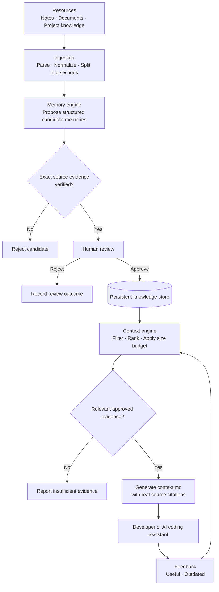

OneBrain
A shared, evidence-backed memory for software teams.
Capture what your team learns. Preserve why it matters. Give every developer and AI coding assistant the context they need.

Your team's knowledge shouldn't disappear into chat history, old pull requests, or someone's memory.

The problem
Software teams repeatedly lose time rediscovering things they already know.
- An architectural decision gets buried in a conversation.
- A difficult bug fix lives in one engineer's head.
- A teammate returns from leave without the context they need.
- An AI coding assistant starts a task without the team's history—and repeats an old mistake.
Existing documents preserve information, but they do not automatically make it easy to verify, connect, and reuse at the moment it matters.
The idea
OneBrain turns scattered team knowledge into approved, traceable memories—and delivers relevant context before work begins.

It remembers:
- Decisions — what the team agreed on and why.
- Bug fixes — what broke, what fixed it, and what to avoid.
- Conventions and constraints — the rules a project follows.
- Lessons and outcomes — what the team learned from previous work.
- Sources — where every piece of knowledge came from.
When a developer starts a task, OneBrain retrieves relevant, approved knowledge and creates a focused context.md for the developer or their AI coding assistant.
How it works

1. Capture resources
Add notes and supported documents. OneBrain preserves their content, identity, section structure, and source metadata so knowledge can be traced back to its origin.
2. Propose memories
The memory engine identifies reusable decisions, fixes, constraints, and lessons. Each candidate must include evidence from a real source. If its quoted evidence cannot be found word for word, the candidate is rejected.
3. Review before trusting
New memories remain suggestions until a person approves them. Conflicting memories are flagged for human resolution rather than silently reconciled by AI.
4. Retrieve the right context
For a task such as “Implement authentication middleware,” OneBrain searches approved memories, ranks relevant results, respects project and access boundaries, and fits the selected evidence into a configurable context budget.
5. Give coding agents useful context
OneBrain generates a context.md containing relevant decisions, fixes, constraints, source references, and unresolved questions. Quoted source material is clearly marked as reference data—not as instructions to follow.
6. Improve through feedback
Team members can mark memories useful or outdated. Feedback may influence retrieval ranking, but it does not silently rewrite memory content or change its approval status.
A concrete example
A team note contains:
Decision: Session middleware must validate signed cookies before any route handler runs.
Fix: The SESSION_TTL setting must be considered when diagnosing session expiry.

OneBrain can propose a memory:
Session validation rule
Session middleware must validate signed cookies before route handlers execute.

The proposal links to the exact sentence in the original note. A reviewer approves it.

Later, a developer asks an AI agent to implement authentication middleware. OneBrain retrieves the approved decision and creates a context pack containing the decision, the source quote, and the source reference.

If someone asks about a billing-invoice-export rule that the knowledge base does not contain, OneBrain reports that it has no approved supporting knowledge instead of inventing an answer.
What makes OneBrain different?
Capability	Why it matters
Exact evidence verification	A memory is accepted only when its source quote matches the original content exactly.
Human approval	AI can propose knowledge, but people decide what becomes trusted team memory.
Persistent memory	Approved knowledge and generated context packs remain available after restart.
Task-specific context	Agents receive relevant information rather than the entire knowledge base.
Conflict awareness	Conflicting memories are surfaced for people to resolve.
Auditable lifecycle	Memory changes and review outcomes can be traced.
Privacy by default	Personal spaces are private by default; sharing is deliberate and reversible.
Zero-cost baseline	The core workflow is designed to run without paid services or mandatory API keys. A local language model is optional.

Core components
Resource layer
Stores source content, unique fingerprints, section structure, metadata, and processing status.
Memory engine
Proposes structured memories, verifies source evidence, manages approval and supersession, and records lifecycle events.
Context engine
Searches approved memories, ranks results, applies project and access filters, respects a size budget, and persists each generated context pack for later inspection.
Workspace and access control
Models team members, roles, teams, AI agents, and documents. Personal spaces are private by default. Authorization should be enforced centrally on every relevant request.
Knowledge interface
The planned experience brings together a desktop-style workspace with a file tree, linked notes, a graph of real relationships, a review queue, a context builder, and source-citing chat.
A graph should visualize actual stored relationships—not decorative or fabricated connections.

Design principles
- Evidence before confidence. No source, no unsupported claim.
- Human-governed memory. Suggestions are not trusted knowledge until approved.
- One source of truth. The database owns persistence; an LLM does not act as the database.
- Private by default. Access is explicit, centralized, and revocable.
- Honest uncertainty. Missing evidence is a valid result.
- Small, verifiable steps. Prefer a working end-to-end flow over disconnected features.
- No required paid AI. The basic workflow must remain usable without paid APIs or API keys.
Architecture at a glance
The logical model separates these entities so their lifecycles and provenance remain clear:
Entity	Purpose
Workspace / Project	Defines the scope in which knowledge belongs.
Resource	Original source material and metadata.
Chunk / Section	Searchable part of a resource, linked to its origin.
Memory	Reusable knowledge proposed or approved by the team.
MemoryRelationship	A typed, traceable link between memories or other entities.
MemoryEvent	Review and lifecycle audit history.
ContextPack	A persisted task-specific set of retrieved evidence.
Feedback	Signals about usefulness or outdated knowledge.

A candidate memory should retain its source resource ID, exact evidence quote, location where available, project association, status, and timestamps. Relationship and approval updates should be validated and protected against concurrent review conflicts.

The exact framework, database, language, and deployment choices must be confirmed from the actual implementation; this README describes the intended product, not an assertion that every component is already built.
Project status
Current stage: design and early implementation planning.

The first milestone is a single, fully verifiable flow:
1. Add a note.
2. Extract a candidate memory.
3. Verify its exact source quote.
4. Approve the memory.
5. Retrieve it for a related task.
6. Generate a context pack with real source references.
7. Restart the server and verify that the resource, memory, and context pack persist.
The first version must also demonstrate that unsupported questions receive an honest insufficient-evidence response.

Advanced graph exploration, semantic retrieval, feedback-driven ranking, and local-model integration can be introduced incrementally after the core flow works.
Evaluation checklist
Use this list to assess the implementation—not as a claim that every item is already complete.
- [ ] A resource can be added and retrieved after restart.
- [ ] Duplicate resource ingestion is handled predictably.
- [ ] Candidate memories include exact, verifiable source quotes.
- [ ] Invalid or unverifiable candidates are rejected.
- [ ] Approval is human-controlled and safe under concurrent requests.
- [ ] Conflicts are flagged for human resolution.
- [ ] Search returns approved memories with real source references.
- [ ] Context packs respect project permissions and size limits.
- [ ] Generated packs are persisted and can be inspected later.
- [ ] Missing evidence is reported honestly.
- [ ] Feedback changes ranking only; it does not silently change memory content or status.
- [ ] Personal spaces are private by default and sharing can be revoked.
- [ ] Tests cover ingestion, provenance, lifecycle, access control, context generation, and persistence.
Technology and open-source dependencies
OneBrain is designed to reuse suitable open-source components where they reduce implementation effort. Potential candidates include:
- Cognee — connected knowledge and memory workflows.
- Mem0 — persistent AI memory.
- Khoj — an open-source knowledge assistant.
- MarkItDown — conversion of supported files into Markdown.
These are candidates for evaluation, not confirmed dependencies. Before relying on any third-party component, verify its current license, supported features, runtime requirements, and fit with the application. OneBrain should not depend on several overlapping frameworks without a clear reason.
Getting started
The project is currently at the design / early-build stage, so verified installation commands are not yet listed here.

Once the implementation is in place, this section should document:
1. Prerequisites and supported runtime versions.
2. Installation and local startup commands.
3. Environment variables, with a safe .env.example.
4. Database setup and migrations, if applicable.
5. How to run automated tests.
6. How to execute the end-to-end demo.
7. Which features work without an LLM and which are optional.
Never commit real secrets or claim a setup command has been verified until it has been run.
Vision
We want a team's experience to remain useful even when conversations are forgotten, projects change, or team members move on.

OneBrain gives software teams and their AI coding assistants a shared place to find what the team knows, why it believes it, and where that knowledge came from.

Capture knowledge. Verify it. Share it deliberately. Put it to work.

OneBrain — team knowledge that survives the conversation.

