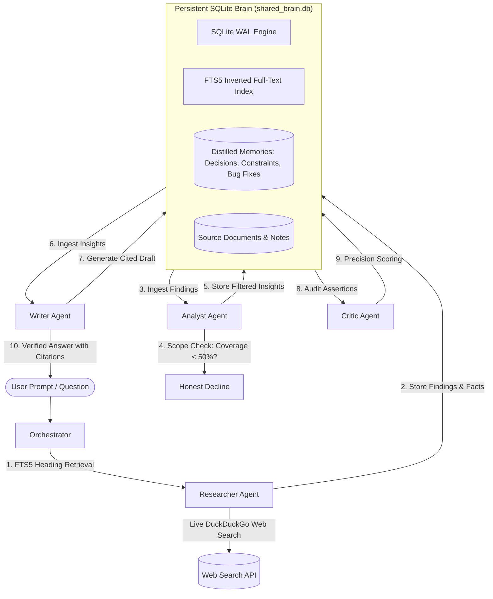
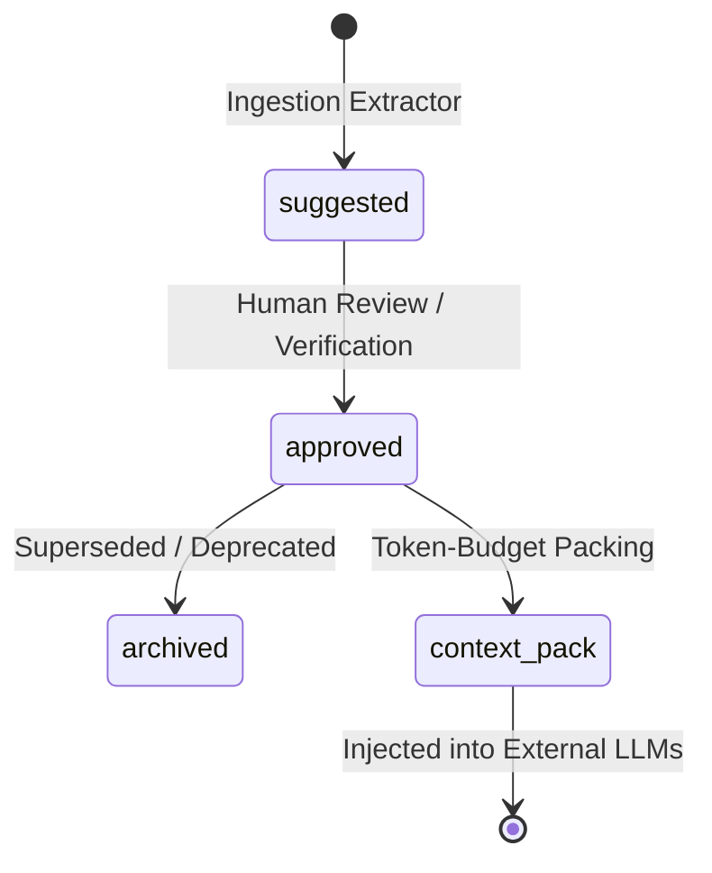

<p align="center">
  
</p>

<h1 align="center">SharedBrain</h1>

<p align="center">
  <strong>The Local-First Persistent Memory Collective for Autonomous AI Agents</strong><br>
  <em>Never amnesic. Completely cited. Honest about what it doesn't know.</em>
</p>

<p align="center">
  <a href="https://github.com/RAMBO-LC/WyredHF2026/releases/tag/v1.0.0"></a>
  <a href="#quick-start"></a>
  <a href="#architecture"></a>
  <a href="#license"></a>
</p>

---

## What is SharedBrain?

Most AI agents today are **isolated and amnesic**: when a session closes, the agent forgets every decision, trade-off, and finding it made. Passing monolithic conversation logs between agents leads to **context bloat**, **hallucinations**, and **skyrocketing API bills**.

**SharedBrain solves this.** It is an embedded multi-agent collective centered around a single, persistent **SQLite** database. A Researcher, Analyst, Writer, and Critic read from and commit to one synchronized brain. Every answer provides line-level citations, and when internal knowledge falls below a 50% coverage threshold, the system **honestly declines** instead of hallucinating.

```
+------------------------------------------------------------------------+
|                        SHARED PERSISTENT BRAIN                         |
|                    (SQLite WAL + FTS5 BM25 Search)                     |
+--------------+-------------------+-------------------+-----------------+
               |                   |                   |
               v                   v                   v
       [Researcher]        ->  [Analyst]       ->  [Writer]        ->  [Critic]
     Headings & Search       Scope & Filter      Cited Summary     Grounding Audit
```

---

## Key Highlights

* **Zero Vector DB Dependencies:** Built on pure `better-sqlite3` with Write-Ahead Logging (WAL) and FTS5 BM25 search. Zero cloud vector bills, sub-millisecond retrieval.
* **4-Agent Autonomous Collective:** Division of labor with specialized roles that hand off atomic findings instead of noisy chat logs.
* **The 50% Anti-Hallucination Rule:** The Analyst audits source coverage against the question; if term coverage is under 50%, the system refuses to guess.
* **Verbatim Line Citations:** Every claim is tied back to exact source document sections and byte offsets.
* **Interactive Knowledge Graph:** Dynamic HTML5 Canvas force-directed graph visualizing document links (`[[wikilinks]]`) and memory clusters.
* **Native macOS Desktop App:** Bundles its own Node.js runtime into an Apple Silicon `.dmg` with a background menu bar companion.
* **Drop-In OpenAI Compatibility:** Exposes `POST /v1/chat/completions` so you can connect **Open WebUI**, **AnythingLLM**, or **Cursor** directly to SharedBrain.

---

## System Architecture



---

## The 4-Agent Pipeline

| Agent | Responsibility | Core Mechanics | Output Memory Kind |
| :--- | :--- | :--- | :--- |
| **Researcher** | Document retrieval & external search | Splits docs into heading chunks; runs BM25 queries & DuckDuckGo API | `finding`, `fact` |
| **Analyst** | Scope validation & synthesis | Measures term overlap against question; filters noise by ~40% | `insight` |
| **Writer** | Grounded deliverable synthesis | Formulates executive answers referencing exact section headers | `summary` |
| **Critic** | Fact checking & verification | Audits what share of claims appear verbatim in the source evidence | `grounding_metric` |

---

## Memory Distillation & Governance

Files imported or dropped into SharedBrain are automatically **distilled** into structured, verifiable atomic memory units:



* **Decisions:** Architecture choices and trade-offs.
* **Constraints:** Non-negotiable security or engineering rules (`must not`, `never`).
* **Conventions:** Team coding standards and protocols.
* **Bug Fixes:** Root causes and verified operational resolutions.

---

## Quick Start

### Prerequisites
* **Node.js 20+** (or use the standalone macOS `.dmg` below)

```bash
# 1. Clone the repository
git clone https://github.com/RAMBO-LC/WyredHF2026.git
cd WyredHF2026

# 2. Install dependencies
npm install

# 3. Start the server
npm run serve
```

Open the web interface in your browser (default port 3000). The first run automatically seeds a rich sample knowledge base. Try asking:
* *"What are the rate limiting tiers?"*
* *"How do I roll back a SEV-1 incident?"*
* *"What is the capital of France?"* *(Correctly declined: outside knowledge scope)*

---

## Native macOS App

We provide a self-contained macOS desktop app with an embedded runtime—no Node.js or terminal required.

<p align="left">
  <a href="https://github.com/RAMBO-LC/WyredHF2026/releases/download/v1.0.0/SharedBrain-1.0.0-arm64.dmg">
    
  </a>
</p>

1. Download [`SharedBrain-1.0.0-arm64.dmg`](https://github.com/RAMBO-LC/WyredHF2026/releases/download/v1.0.0/SharedBrain-1.0.0-arm64.dmg) from the Releases page.
2. Open the DMG and drag **SharedBrain** into your **Applications** folder.
3. Launch the app. A menu bar status item provides one-click access to the UI, data directory, and watched incoming folder.

---

## API & External Integrations

### Ingest Documents
```bash
curl -s http://127.0.0.1:3000/api/ingest -H 'Content-Type: application/json' \
  -d '{"title":"Security Policy","content":"# Security Policy\nRaw credit card numbers must never be logged."}'
```

### Ask Grounded Questions
```bash
curl -s http://127.0.0.1:3000/api/ask -H 'Content-Type: application/json' \
  -d '{"question":"Can we log credit card numbers?"}'
```

### OpenAI-Compatible Gateway (`/v1/chat/completions`)
Connect tools like **Open WebUI**, **Cursor**, or custom Python agents by pointing `base_url` to SharedBrain:

```python
from openai import OpenAI

client = OpenAI(
    base_url="http://127.0.0.1:3000/v1",
    api_key="sb_local_token"
)

response = client.chat.completions.create(
    model="sharedbrain",
    messages=[{"role": "user", "content": "Explain our deployment guidelines."}]
)
print(response.choices[0].message.content)
```

---

## Command-Line Interface (CLI)

SharedBrain includes a full terminal suite with ANSI-colored streaming boxes:

```bash
# Ask an instant cited question
npm run cli -- ask "How do webhook retries work?"

# Run a full multi-agent collaborative investigation
npm run cli -- run "Compare SQLite WAL vs Postgres for local edge caching"

# Inspect database memory count, disk size, and agent contributions
npm run cli -- memory stats

# Full-text search across all stored memories
npm run cli -- memory search "circuit breaker"

# Launch interactive REPL session
npm run cli -- interactive
```

---

## Testing & Verification

```bash
npm test          # Run Vitest test suite across CRUD, tools, and agents
npm run eval      # Run automated retrieval benchmark (Recall@5 & Precision@5)
npm run accept    # Validate the 8 core memory-engine invariants
npm run build     # Compile TypeScript to dist/
docker compose up --build # Run fully containerized via Docker
```

---

## License

This project is licensed under the [MIT License](LICENSE).
