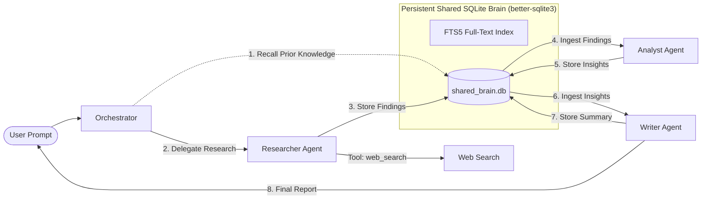

# 🧠 SharedBrain

> A lightweight, local-first multi-agent AI collective where specialized agents collaborate seamlessly through a **persistent, shared SQLite memory layer**.

[](file:///Users/tatvagnatandel/Documents/gemini-chat/LLM-AGENT/test)
[](https://nodejs.org)
[](https://github.com/WiseLibs/better-sqlite3)
[](LICENSE)

---

## 💡 The Core Problem

Most AI agents today are **isolated** and **amnesic**:
1. When a session terminates, the agent forgets every fact, finding, and decision it made.
2. In typical multi-agent setups, agents pass monolithic context windows back and forth, leading to severe token bloat, context pollution, and hallucinations.
3. Startups and teams lack a shared institutional memory that compounds over time.

**SharedBrain solves this.** All specialized agents read from and write to a single, persistent **SQLite** database (`shared_brain.db`). Knowledge accumulated by one agent is immediately indexed and accessible to all other agents—both within the current task and across application restarts.

---

## 🏛️ High-Level Architecture

```
/src
  /agents          → Specialized agent implementations
    ├── baseAgent.ts        # Abstract BaseAgent with memory hooks & OpenAI tool-calling
    ├── researcherAgent.ts  # Information gathering, web search, raw findings
    ├── analystAgent.ts     # Deep synthesis, trade-off analysis, structural insights
    └── writerAgent.ts      # Executive summaries, polished final deliverable
  /memory          → Shared persistent SQLite memory layer
    ├── sharedMemory.ts     # SQLite storage, FTS5 full-text search, transactions
    └── index.ts
  /orchestrator    → Coordinates workflow, handoffs, and lifecycle events
    └── orchestrator.ts     # Routes tasks, triggers handoffs, logs events
  /tools           → Shared tools for agents
    ├── webSearch.ts        # Live web search (DuckDuckGo API + offline fallback)
    └── memoryTools.ts      # memory_recall and memory_store tools
  /cli             → Sleek terminal interface with colored progress & boxes
    ├── ui.ts               # Terminal UI formatting with picocolors
    └── index.ts            # CLI command runner (run, demo, ask, memory, interactive)
  index.ts         → Programmatic entry point & SDK export
```

### Multi-Agent Handoff Pipeline



---

## 🤖 Specialized Agents

| Agent | Role | Tools Used | Default Memory Output |
| :--- | :--- | :--- | :--- |
| **🔍 Researcher** | Gathers empirical facts, verifies information, explores external sources | `web_search`, `memory_recall` | `finding`, `fact` |
| **📊 Analyst** | Ingests raw findings from SQLite, filters noise by ~40%, evaluates trade-offs | `memory_recall` | `insight` |
| **✍️ Writer** | Reads synthesized insights, crafts executive reports and action plans | `memory_recall` | `summary` |
| **🎼 Orchestrator** | Receives task, executes handoffs, recalls prior sessions, logs provenance | N/A | `plan`, task run record |

---

## 💾 Shared Persistent Memory Layer

The memory system uses **`better-sqlite3`** with:
- **Write-Ahead Logging (WAL)**: Sub-millisecond synchronous reads and atomic transactions.
- **SQLite FTS5 Full-Text Search**: Automatic inverted index on `content`, `tags`, and `agent` with BM25 relevance ranking.
- **SQLite Triggers**: `AFTER INSERT`, `AFTER UPDATE`, and `AFTER DELETE` triggers keep the search index synchronized in real time.
- **Cross-Session Persistence**: Database is stored in `./data/shared_brain.db`. If you restart the terminal or re-run the CLI days later, all memories are preserved and recalled.

### Memory Schema

```sql
CREATE TABLE memories (
  id TEXT PRIMARY KEY,
  content TEXT NOT NULL,
  type TEXT NOT NULL,        -- 'fact' | 'finding' | 'insight' | 'summary' | 'raw' | 'plan'
  agent TEXT NOT NULL,       -- 'researcher' | 'analyst' | 'writer' | 'orchestrator' | 'user'
  timestamp TEXT NOT NULL,   -- ISO 8601 string
  tags TEXT NOT NULL,        -- JSON array of keyword strings
  task_id TEXT,              -- UUID grouping memories for a specific run
  metadata TEXT              -- JSON object for extra provenance/citations
);
```

---

## ⚡ Quick Start

### 1. Installation

```bash
# Clone the repository
git clone <repo-url>
cd LLM-AGENT

# Install dependencies (Node.js 18+ required)
npm install
```

### 2. Configuration (Optional)

Create a `.env` file if you want to use OpenAI or an OpenAI-compatible provider:

```bash
cp .env.example .env
```

```env
# Optional: Set your OpenAI API key
OPENAI_API_KEY=sk-...

# Optional: Custom model or endpoint (works with Ollama, Groq, OpenRouter)
OPENAI_MODEL=gpt-4o
# OPENAI_BASE_URL=https://api.openai.com/v1

# SQLite database file path
DATABASE_PATH=./data/shared_brain.db
```

> **Note for Hackathon Judges & Offline Demos**: If `OPENAI_API_KEY` is not set, SharedBrain automatically runs in **intelligent local mode** with deterministic agent reasoning and full SQLite persistence. You can run the entire system offline with zero configuration!

---

## 🚀 Running the System

### Run the Live Demo

Run the automated end-to-end demonstration showcasing multi-agent handoffs, intermediate reasoning, SQLite commits, and cross-session memory recall:

```bash
npm run demo
```

### Run a Custom Task

Dispatch any task to the multi-agent collective:

```bash
npm run cli -- run "Investigate the trade-offs of microservices vs monoliths"
```

Or run interactively:

```bash
npm start
```

### Recall Knowledge Across Sessions (`ask`)

Demonstrate that memories persist across application restarts by asking a question about previous work:

```bash
npm run cli -- ask "What did the analyst say about SQLite?"
```

### Inspect the Persistent Memory

```bash
# View database statistics (total count, breakdown by agent, file size)
npm run cli -- memory stats

# List recent memories saved in SQLite
npm run cli -- memory list

# Search memories using SQLite FTS5 full-text search
npm run cli -- memory search "multi-agent"

# Clear database for a clean start
npm run cli -- memory clear
```

### Interactive REPL Mode

Launch the interactive shell to continuously submit tasks, ask questions, and query the collective brain:

```bash
npm run cli -- interactive
```

---

## 🧪 Testing

Vitest test suite covering unit operations, database persistence across restarts, tool calling, and orchestrator lifecycle events:

```bash
# Run all tests
npm test
```

### Test Coverage Highlights:
- **`test/memory.test.ts`**: SQLite CRUD, transactions, FTS5 recall, restart persistence, database size and statistics.
- **`test/tools.test.ts`**: WebSearchTool live/offline queries, MemoryStoreTool, MemoryRecallTool.
- **`test/agents.test.ts`**: Researcher, Analyst, and Writer specialized workflows and memory emissions.
- **`test/orchestrator.test.ts`**: Multi-agent handoff pipeline, lifecycle hooks, and cross-session knowledge recall.

---

## 🛠️ Tech Stack & Philosophy

- **Runtime**: Node.js & TypeScript
- **Memory Storage**: `better-sqlite3` with Write-Ahead Logging (WAL) and FTS5
- **AI Compatibility**: OpenAI SDK (compatible with OpenAI, Ollama, Groq, OpenRouter)
- **Terminal UI**: `picocolors` and `commander`
- **Testing**: `vitest`
- **Design Philosophy**: Zero Docker, zero cloud vector database bills, local-first speed, clean modular architecture.
